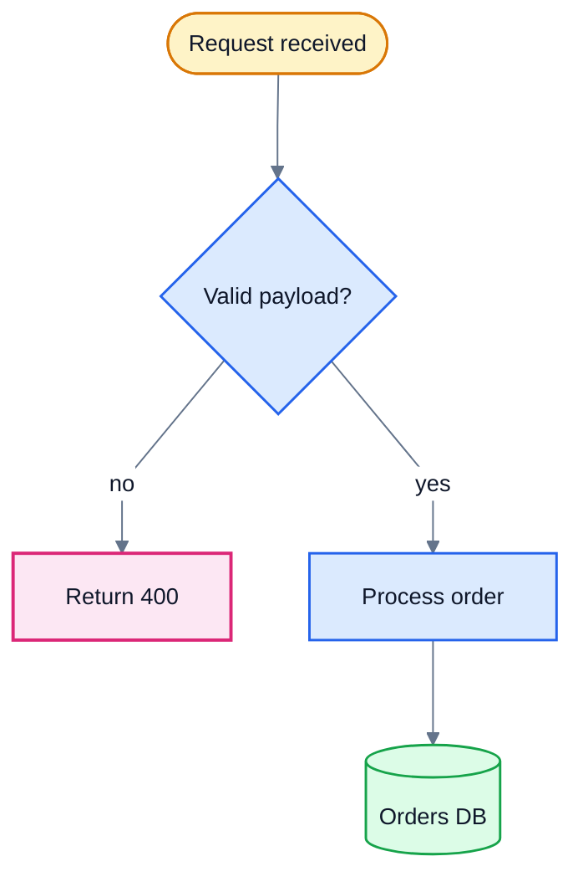
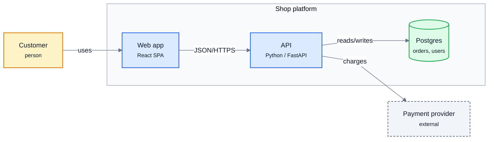
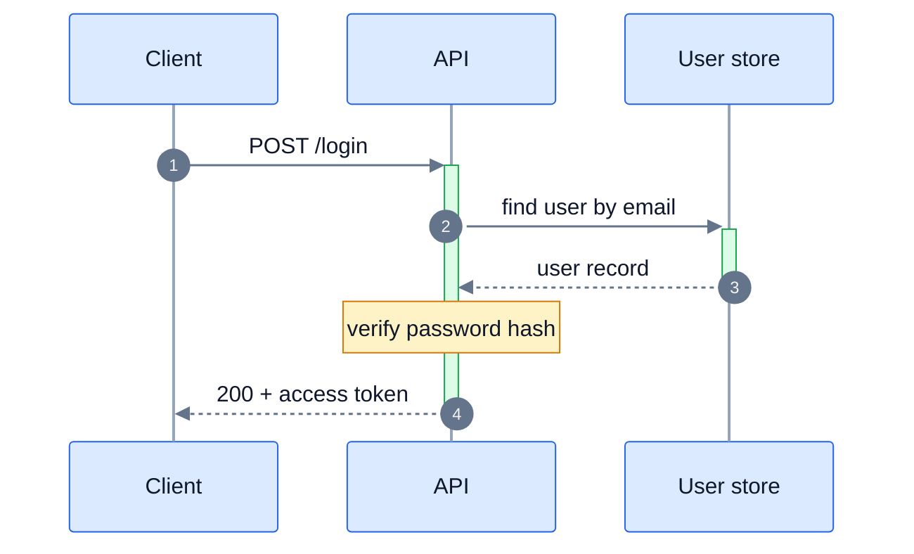
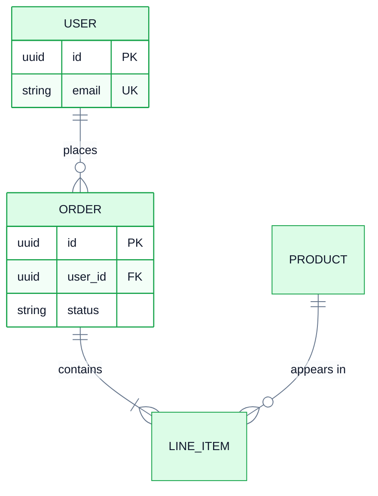
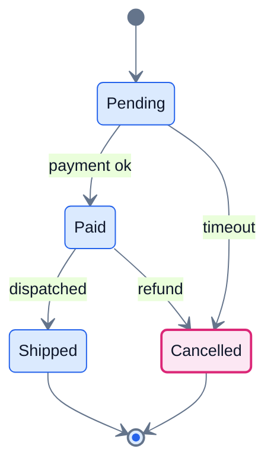

# Mermaid templates (shared palette)

Every template uses the same `%%{init}%%` block and `classDef` palette.

**How the palette survives both themes:**
- Node fills are light tints with dark text, so they stay readable on light **and** dark page backgrounds.
- Edges and borders use mid-tone slate, which has enough contrast on both.

| Role | classDef | Fill | Stroke | Use for |
|---|---|---|---|---|
| svc | `svc` | `#DBEAFE` | `#2563EB` | services, modules, functions |
| data | `data` | `#DCFCE7` | `#16A34A` | databases, queues, caches, files |
| ext | `ext` | `#F1F5F9` | `#64748B` | third-party / external systems (dashed) |
| user | `user` | `#FEF3C7` | `#D97706` | people, actors, clients |
| accent | `accent` | `#FCE7F3` | `#DB2777` | the one thing the reader should notice |
| err | `err` | `#FEE2E2` | `#DC2626` | error, deny and failure paths |

Copy the init line and classDefs **verbatim** and change only the nodes and edges. The `flowchart` settings in the init line (straight edges, 48px node spacing, 64px rank spacing, 16px padding) make every flowchart lay out the same way; don't change them per diagram.

## Flowchart (decisions / processes)



## C4-style container view (systems / architecture)

Built with a flowchart and subgraphs, so it renders everywhere and shares the palette. Native `C4Container` ignores classDef.



## Sequence (interactions over time)

Sequence diagrams ignore classDef. The init block sets actor and note colors from the same palette.



## ER (data model)



## State (lifecycle)



## Checklist before handing off
- [ ] At most 12 nodes; one direction; few crossings.
- [ ] Palette copied verbatim; roles used for meaning, with a legend if more than 2 roles.
- [ ] `accTitle` + `accDescr` present.
- [ ] Every node and edge traces to a real `path:line` or system.
- [ ] `python3 .claude/tools/svg_lint.py <file>` shows no ERROR.

## Dark theme

Use this only when `diagrams.theme` in `.claude/harness.json` is `dark`. Replace the `themeVariables` and the classDefs; keep everything else, including the `flowchart` layout settings.

```text
'themeVariables':{'fontFamily':'ui-sans-serif, system-ui, sans-serif','fontSize':'14px','background':'#0B1220','primaryColor':'#1E3A8A','primaryTextColor':'#E2E8F0','primaryBorderColor':'#60A5FA','lineColor':'#94A3B8','secondaryColor':'#14532D','tertiaryColor':'#1E293B','clusterBkg':'#0F172A','clusterBorder':'#475569','edgeLabelBackground':'#0B1220'}

classDef svc fill:#1E3A8A,stroke:#60A5FA,stroke-width:1.5px,color:#E2E8F0
classDef data fill:#14532D,stroke:#4ADE80,stroke-width:1.5px,color:#E2E8F0
classDef ext fill:#1E293B,stroke:#94A3B8,stroke-width:1.5px,stroke-dasharray:4 3,color:#E2E8F0
classDef user fill:#78350F,stroke:#FBBF24,stroke-width:1.5px,color:#E2E8F0
classDef accent fill:#831843,stroke:#F472B6,stroke-width:2px,color:#E2E8F0
classDef err fill:#450A0A,stroke:#F87171,stroke-width:1.5px,color:#E2E8F0
```
